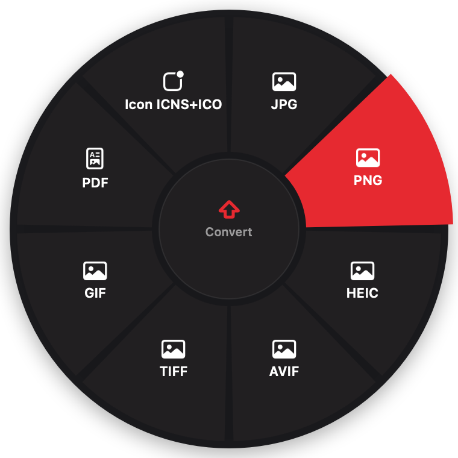
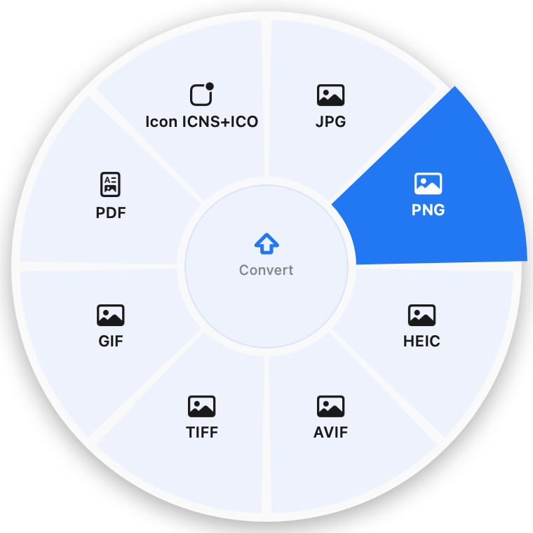

<p align="center">
  
</p>

<h1 align="center">Rondo</h1>

<p align="center">
  <b>A radial-menu file converter for macOS.</b><br>
  Drag a file, hold <kbd>⇧</kbd> <kbd>⌃</kbd> or <kbd>⌥</kbd>, and drop it on a format.
</p>

<p align="center">
  <a href="https://github.com/kstepanchuk/rondo/releases/latest"></a>
  <a href="https://github.com/kstepanchuk/rondo/releases"></a>
  
  
  <a href="LICENSE"></a>
  <a href="https://github.com/kstepanchuk/rondo/actions/workflows/ci.yml"></a>
</p>

<h3 align="center"><a href="https://kstepanchuk.github.io/rondo/">▶ Try the wheel in your browser</a></h3>

<p align="center">
  <b>English</b> · <a href="README.ru.md">Русский</a>
</p>

<p align="center">
  <a href="#install"><b>Install</b></a> ·
  <a href="#how-it-works"><b>How it works</b></a> ·
  <a href="#features"><b>Features</b></a> ·
  <a href="#privacy--security"><b>Privacy</b></a>
</p>

<p align="center">
  
  &nbsp;
  
</p>

<table>
  <tr>
    <td width="33%" valign="top"><b>🎯 Right at your cursor</b><br>No windows, no dialogs. The wheel only shows what makes sense for the files you're dragging.</td>
    <td width="33%" valign="top"><b>🔒 Stays on your Mac</b><br>Nothing is uploaded. Even OCR and speech-to-text run offline.</td>
    <td width="33%" valign="top"><b>🆓 Free and open source</b><br>MIT license, no accounts, no limits, no telemetry.</td>
  </tr>
</table>

## Install

**Homebrew**

```bash
brew install --cask kstepanchuk/rondo/rondo
```

**DMG**: download `Rondo-x.y.z.dmg` from [Releases](https://github.com/kstepanchuk/rondo/releases/latest) and drag Rondo to Applications.

> [!NOTE]
> Rondo isn't notarized yet. If macOS won't open it after installing from the DMG, drag **Разрешить запуск** (“Allow launch”) from the DMG into a Terminal window and press Return: it removes the download quarantine from Rondo.app only and opens it. Or use *System Settings → Privacy & Security → Open Anyway*. Homebrew installs don't need this.

**Optional engines:**

```bash
brew install ffmpeg pandoc sevenzip
```

DOCX, XLSX and PPTX to PDF use Microsoft Office or Keynote when available. Otherwise, install the open-source LibreOffice command-line converter with `brew install --cask libreoffice`; Rondo runs it headlessly and keeps files on your Mac. If you have both, pick the engine in Settings → Tools → *Document engine*.

**Updates.** Rondo checks GitHub Releases once a day, verifies the update's SHA-256 and code signature, and relaunches itself. You can also use *Check for Updates…* in the menu.

## How it works

| | Key | Wheel |
|---|---|---|
| 🔄 | <kbd>⇧ Shift</kbd> | Convert |
| 🛠 | <kbd>⌃ Control</kbd> | Tools |
| ⚡️ | <kbd>⌥ Option</kbd> | Actions |

1. Start dragging a file (or several) from Finder, a browser, Mail or Photos.
2. Hold a modifier key and the wheel opens at your cursor. Switch keys mid-drag, or **scroll** over the wheel.
3. Drop the file on a sector. The centre of the wheel cancels. Rest on **More ›** for the second ring.

**Keyboard**: select files in Finder and press <kbd>⌃⌥Space</kbd>. <kbd>Tab</kbd> switches wheels, arrows and <kbd>Enter</kbd> choose, <kbd>Esc</kbd> closes.
**Context menu**: right-click → Services → **Rondo…**
**Shortcuts & Spotlight**: *Convert Files with Rondo* (any format), *Convert to JPEG*, *Compress* and *Convert to PDF* work in the Shortcuts app, folder automations and Spotlight, no wheel needed.
**Watch folders**: in Settings, pick a folder and an action; new files in it are converted automatically into its *Done* subfolder.

**Command line**: the same engine in Terminal.

```bash
rondo convert --to jpg *.heic        # results next to each original (or --out DIR)
rondo list photo.CR3                 # what this file can become
rondo run fit-8 video.mp4            # any operation by id, e.g. fit under 8 MB
rondo info photo.CR3                 # camera, lens, exposure, codecs, pages…
```

## Features

<details open>
<summary><b>🔄 Convert</b></summary>

| From | To |
|---|---|
| Images | JPG, PNG, HEIC, AVIF, **WebP** ⁵, TIFF, GIF, PDF, app icons **ICNS + ICO** |
| 📷 Camera RAW | JPG, HEIC, **16-bit TIFF**, PNG, AVIF, keeping EXIF. Canon CR2/CR3, Nikon NEF, Sony ARW, Fuji RAF, DNG, Olympus, Panasonic and more |
| Video ¹ | MP4, MOV, WebM, GIF, MP3 · **rewrap without re-encoding** |
| Audio ¹ | MP3, WAV, M4A, FLAC, OGG |
| Documents | DOCX, RTF, TXT, HTML, ODT · PDF ³ · Markdown, EPUB ² |
| Markdown ² | DOCX, HTML, EPUB, PDF ³ |
| Spreadsheets ³ | PDF, CSV, XLSX · CSV → XLSX |
| Presentations ³ | PDF |
| PDF | TXT, PNG |
| Subtitles | SRT ⇄ VTT |
| Data | JSON ⇄ YAML ⇄ CSV ⇄ XLSX, no Office needed |

</details>

<details open>
<summary><b>🛠 Tools</b></summary>

- **Images**: **crop** (1:1, 4:5, 9:16, 16:9… in an editor) and square, remove background, **fit under 1 / 5 / 8 / 25 MB**, shrink, rotate, flip, strip EXIF and GPS, text recognition (OCR), read QR codes, web-ready, colour palette.
- **RAW**: crop, fit under N MB, instant preview (the camera's embedded JPEG), shot info to the clipboard (camera, lens, shutter, aperture, ISO), web-ready, palette.
- **PDF**: explode to PNG, OCR, QR, split into pages, compress, **rotate, page numbers, keep / delete pages, watermark**.
- **Presentations** ³: explode to PNG. 16:9 slides come out at exactly **1920×1080**.
- **Video** ¹: **fit under 8 / 25 MB** (Discord, mail), **trim and crop** (16:9, 9:16, 1:1, 4:5) in a QuickTime-style editor, compress, mute, first frame, extract subtitles, vertical **9:16** for Reels and Shorts, **720p, rotate, 2× speed**, transcribe speech.
- **Audio** ¹: **tags and cover art**, **trim**, mono, normalize loudness, remove silence, transcribe speech.
- **Text**: **to UTF-8** from Windows-1251, KOI8-R, DOS-866, UTF-16 (TXT, CSV, SRT, MD, JSON…).
- **Several files**: merge into one PDF, collage, **join videos or audio** into one file.
- Compressing shows the savings: `1.2 MB → 340 KB (−72 %)`.

</details>

<details open>
<summary><b>⚡️ Actions</b></summary>

ZIP, AirDrop, **Send to phone** (QR code, local Wi-Fi, 5–30 min), **custom icon** for a folder or file, **Share** to any app, **Shelf** (a floating tray to drag files back out of), **Move to…**, copy path, reveal in Finder, **open in Terminal**, **metadata** (camera, GPS, codecs, PDF info), SHA-256, duplicate, 7Z ⁴, extract (ZIP, 7Z, RAR, TAR…), ZIP several files.

**🎛 Resolume Arena**: drop a folder of slides with ⌥ on *Arena deck*. Arena gets a new deck named after the folder, with the images and videos loaded into layer 1 in order (1, 2 … 10). Needs Arena's webserver on (Preferences → Webserver; the port is configurable in advanced settings).

**Your own actions**: create a **Rondo** folder in the Shortcuts app and its shortcuts show up on this wheel.

</details>

Also: **Undo** and drag-out right in the result notification, hints in the wheel's hub, a file card under the wheel, the wheel learns your most-used order, and a welcome tour.

<sub>¹ ffmpeg · ² pandoc · ³ Microsoft Office or Keynote · ⁴ sevenzip · ⁵ webp (cwebp)</sub>

## Settings

- Theme: system, dark (red and black) or light (white and blue).
- Language: system, English or Russian.
- Where results go: **next to the original** (default) or `~/Downloads/Rondo`.
- Open at login, reveal results in Finder, automatic updates.
- **Advanced** (optional): JPG/HEIC and video quality, web-ready size, remap the wheel keys (⇧ ⌃ ⌥ ⌘), reorder and hide sectors per file type.
- Engine status, with one-click install for anything missing.

## Privacy & security

- Files never leave your Mac and there's no telemetry. The only network call is the update check on GitHub.
- Originals are never overwritten: name clashes get ` (2)`, ` (3)`…
- ffmpeg is limited to the `file` protocol and pandoc runs with `--sandbox`. Archives can't extract outside their folder.
- No Accessibility permission needed: modifier keys are read without a keyboard hook.
- Hardened runtime. The only entitlement is automation of Finder and Office.

## Build

```bash
./scripts/build.sh 0.2.0     # dist/Rondo.app, Rondo-0.2.0.dmg and .sha256
./scripts/ci-test.sh         # end-to-end tests, the same ones CI runs
```

To release: `git tag vX.Y.Z && git push --tags`. GitHub Actions builds and publishes the DMG.

Contributions are welcome, see [CONTRIBUTING.md](CONTRIBUTING.md).

## Credits

Inspired by [Sweetch](https://github.com/krllmrzv/Sweetch) (@mmmorozov), [Filee](https://github.com/KnifeLemon/Filee) and [Tangerine](https://tangerineformac.com). The code is written from scratch.

MIT License.
