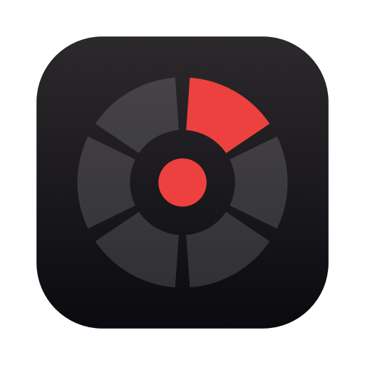
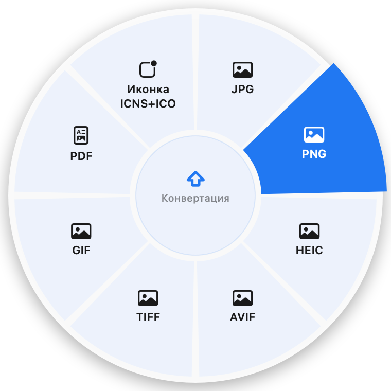

<p align="center">
  
</p>

<h1 align="center">Rondo</h1>

<p align="center">
  <b>Конвертер файлов для macOS с круговым меню.</b><br>
  Тяните файл, зажмите <kbd>⇧</kbd> <kbd>⌃</kbd> или <kbd>⌥</kbd> и отпустите над нужным форматом.
</p>

<p align="center">
  <a href="https://github.com/kstepanchuk/rondo/releases/latest"></a>
  <a href="https://github.com/kstepanchuk/rondo/releases"></a>
  
  
  <a href="LICENSE"></a>
</p>

<p align="center">
  <a href="#установка"><b>Установка</b></a> ·
  <a href="#возможности"><b>Возможности</b></a> ·
  <a href="#приватность-и-безопасность"><b>Приватность</b></a> ·
  <a href="#english"><b>English</b></a>
</p>

<p align="center">
  
  &nbsp;
  
</p>

<table>
  <tr>
    <td width="33%" valign="top"><b>🎯 У курсора</b><br>Без окон и диалогов. Меню показывает только то, что подходит перетаскиваемым файлам.</td>
    <td width="33%" valign="top"><b>🔒 Только локально</b><br>Ничего не загружается в интернет. Даже распознавание речи и текста работает офлайн.</td>
    <td width="33%" valign="top"><b>⚡️ Без лишнего</b><br>Изображения, PDF, OCR и архивы работают сразу. ffmpeg, pandoc и Office нужны только для своих форматов.</td>
  </tr>
</table>

## Установка

**Homebrew**

```bash
brew install --cask kstepanchuk/rondo/rondo
```

**DMG**: скачайте `Rondo-x.y.z.dmg` из [Releases](https://github.com/kstepanchuk/rondo/releases/latest) и перетащите Rondo в «Программы».

> [!NOTE]
> Приложение не нотаризовано. При установке из DMG откройте его первый раз так: *Системные настройки → Конфиденциальность и безопасность → Всё равно открыть*. При установке через brew это не нужно.

**Дополнительные движки** (по желанию):

```bash
brew install ffmpeg pandoc sevenzip
```

Конвертация DOCX, XLSX и PPTX в PDF использует Microsoft Word, Excel и PowerPoint (или Keynote), если они установлены.

**Обновления.** Rondo раз в день проверяет GitHub Releases, перед установкой сверяет SHA-256 и подпись и сам перезапускается. Проверить вручную можно через меню «Проверить обновления…».

## Как пользоваться

| | Клавиша | Режим |
|---|---|---|
| 🔄 | <kbd>⇧ Shift</kbd> | Конвертация |
| 🛠 | <kbd>⌃ Control</kbd> | Инструменты |
| ⚡️ | <kbd>⌥ Option</kbd> | Действия |

1. Начните тянуть файл (или несколько) из Finder, браузера, Почты или Фото.
2. Зажмите модификатор: у курсора раскроется колесо. Модификатор можно менять на ходу.
3. Отпустите файл над сектором. Центр колеса отменяет действие.

**Без мыши**: выделите файлы в Finder и нажмите <kbd>⌃⌥Space</kbd>. <kbd>Tab</kbd> меняет режим, стрелки и <kbd>Enter</kbd> выбирают, <kbd>Esc</kbd> закрывает меню.
**Через контекстное меню**: правый клик → Службы → **Rondo…**

## Возможности

<details open>
<summary><b>🔄 Конвертация</b></summary>

| Что | Во что |
|---|---|
| Изображения | JPG, PNG, HEIC, AVIF, TIFF, GIF, PDF, иконки **ICNS + ICO** |
| Видео ¹ | MP4, MOV, WebM, GIF, MP3 |
| Аудио ¹ | MP3, WAV, M4A, FLAC, OGG |
| Документы | DOCX, RTF, TXT, HTML, ODT · PDF ³ · Markdown, EPUB ² |
| Markdown ² | DOCX, HTML, EPUB, PDF ³ |
| Таблицы ³ | PDF, CSV, XLSX · CSV → XLSX |
| Презентации ³ | PDF |
| PDF | TXT, PNG |
| Субтитры | SRT ⇄ VTT |

</details>

<details open>
<summary><b>🛠 Инструменты</b></summary>

- **Изображения**: убрать фон, уменьшить, повернуть, отразить, удалить EXIF и GPS, распознать текст (OCR), прочитать QR-код, подготовить «для веба» (≤ 2048 px, JPEG 80 %), извлечь палитру цветов.
- **PDF**: разложить в PNG, OCR, QR, разбить по страницам, сжать.
- **Презентации** ³: разложить в PNG. Слайды 16:9 получаются ровно **1920×1080**.
- **Видео** ¹: сжать, убрать звук, первый кадр, извлечь субтитры, вертикаль **9:16** для Reels и Shorts, расшифровать речь.
- **Аудио** ¹: моно, выровнять громкость, убрать тишину, расшифровать речь.
- **Несколько файлов**: объединить в PDF, коллаж.

</details>

<details open>
<summary><b>⚡️ Действия</b></summary>

ZIP, 7Z ⁴, распаковать (ZIP, 7Z, RAR, TAR…), AirDrop, SHA-256 в буфер, копировать путь, показать в Finder, дубликат, ZIP нескольких файлов.

**Свои действия**: создайте в «Быстрых командах» папку **Rondo**, и её команды появятся в этом колесе.

</details>

<sub>¹ ffmpeg · ² pandoc · ³ Microsoft Office или Keynote · ⁴ sevenzip</sub>

## Настройки

- Тема: как в системе, тёмная (красно-чёрная) или светлая (бело-голубая).
- Язык: как в системе, русский или английский.
- Куда сохранять: **рядом с исходным файлом** (по умолчанию) или в `~/Downloads/Rondo`.
- Запуск при входе в систему, показ результата в Finder, автообновления.
- Статус движков и команды для их установки в один клик.

## Приватность и безопасность

- Файлы не покидают Mac, телеметрии нет. В сеть приложение выходит только для проверки обновлений на GitHub.
- Исходные файлы не перезаписываются: при совпадении имён добавляется ` (2)`, ` (3)`…
- ffmpeg работает только с протоколом `file`, pandoc запускается с `--sandbox`. Архивы не распаковываются за пределы папки.
- Не нужен «Универсальный доступ»: модификаторы считываются без перехвата клавиатуры.
- Hardened runtime. Из прав запрашивается только управление Finder и Office.

## Сборка

```bash
./scripts/build.sh 0.1.1     # dist/Rondo.app, .zip, .dmg и .sha256
dist/Rondo.app/Contents/MacOS/Rondo --self-test ./samples [--office]
```

Релиз: `git tag vX.Y.Z && git push --tags`, после чего GitHub Actions соберёт и опубликует DMG и ZIP.

## Благодарности

Идея вдохновлена [Sweetch](https://github.com/krllmrzv/Sweetch) (@mmmorozov), [Filee](https://github.com/KnifeLemon/Filee) и [Tangerine](https://tangerineformac.com). Код написан с нуля.

---

## English

<p align="center"><b>A radial-menu file converter for macOS.</b> Drag a file, hold <kbd>⇧</kbd> to convert, <kbd>⌃</kbd> for tools or <kbd>⌥</kbd> for actions, and drop it on a sector.</p>

```bash
brew install --cask kstepanchuk/rondo/rondo
```

Or grab the DMG from [Releases](https://github.com/kstepanchuk/rondo/releases/latest).

- Images, PDF, OCR, QR, background removal, palettes, app icons, archives and checksums work with nothing else installed.
- Audio and video need `ffmpeg`, Markdown and EPUB need `pandoc`. Office documents use Word, Excel and PowerPoint (or Keynote).
- Results are saved next to the original by default. Originals are never overwritten.
- Everything runs on your Mac, including speech-to-text. The only network call is the update check, and every update is verified by SHA-256 and code signature.
- Your own Shortcuts from the **Rondo** folder show up as actions.

MIT License.
